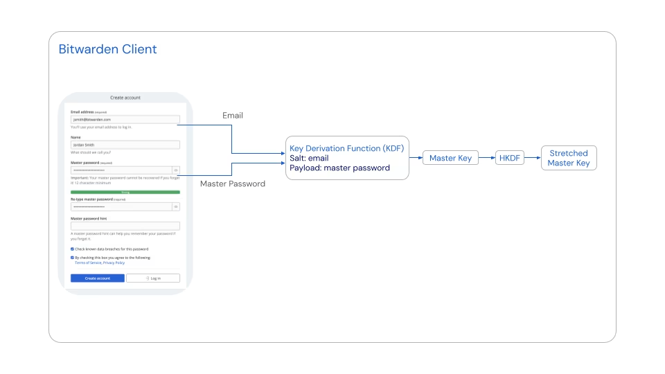

# Encryption

white paper url: https://bitwarden.com/help/bitwarden-security-white-paper

- The Bitwarden Security and Compliance Program is based on the ISO27001 Information Security Management System (ISMS)

## Key security measures

### Key security measures

Lock your passwords and private information with end-to-end AES-CBC 256 bit encryption with HMAC authentication, salted hashing, and Key Derivation Functions such as PBKDF2 SHA-256 or Argon2id. All cryptographic keys are generated and managed by the client on your devices, and all encryption is done locally.

### Zero knowledge encryption

Bitwarden team members cannot see your passwords. Your data remains end-to-end encrypted with your individual email and master password. Bitwarden never stores and cannot access your master password or your cryptographic keys.

### Zero knowledge encryption

Bitwarden team members cannot see your passwords. Your data remains end-to-end encrypted with your individual email and master password. Bitwarden never stores and cannot access your master password or your cryptographic keys.

### Zero knowledge encryption

Bitwarden team members cannot see your passwords. Your data remains end-to-end encrypted with your individual email and master password. Bitwarden never stores and cannot access your master password or your cryptographic keys.

---

## Security tools for users

### Master passwords

- User data protection in Bitwarden begins the moment a user creates an account and a master password. A master password is the token a user uses to access their vault, where sensitive data is stored.

It is very important that users never forget their master passwords. Master passwords are:

- Cleared or marked for removal from memory after usage.
- Never transmitted over the internet to Bitwarden servers.
- Unable to be seen, read, or reverse engineered by anyone at Bitwarden.

forgetting a master password will result in a user being locked out of their account unless they have **emergency access** or **account recovery** active, both of which will be covered later in this paper.

### Two-step login

Two-step login (also called "two-factor authentication" or "2FA") is an extra layer of security for online accounts, designed to protect access to Bitwarden even if someone has the master password. When two-step login is active, users are required to complete a secondary step while logging into Bitwarden, like using a FIDO2 security key or an authenticator app to confirm the login attempt. As a best practice, Bitwarden recommends all users activate and use two-step login.

- Bitwarden provides users a recovery code that they can use to turn off two-step login in the event a secondary device is lost, for example if a YubiKey goes missing. **Users should retrieve and save their recovery code immediately after activating the feature**

### Emergency access

Premium users, including members of paid organizations (Families, Teams, or Enterprise) can designate trusted emergency contacts who may request access to their vault in cases of emergency. Trusted emergency contacts can be assigned either view-only or takeover access to users' accounts.

### Account recovery

Account recovery allows designated administrators of Enterprise organizations to recover member accounts and restore access in the event that an employee forgets their master password. Businesses may also wish to use account recovery to reclaim ownership of a member's account when an employment relationship is ended.

---

## Hashing, key derivation, and encryption

### Account Creation – Encryption Process

1\. PBKDF2 (600,000 iterations)

- Combines the Master Password with the user's email address as a salt.
- Reason: Makes password cracking harder by increasing the computational cost of guessing passwords.

2\. Generate Master Key (256-bit)

- PBKDF2 produces a 256-bit Master Key.
- Reason: Converts the user's password into a strong cryptographic key suitable for encryption.

3\. HKDF (HMAC-based Key Derivation Function)

- Stretches the 256-bit Master Key into a 512-bit Stretched Master Key.
- Reason: Derives a longer cryptographic key for securely encrypting and protecting other encryption keys.

4\. Local Key Processing

- The Master Key and Stretched Master Key are never stored on or transmitted to Bitwarden servers.
- Reason: Ensures Bitwarden servers cannot directly access these keys, maintaining zero-knowledge encryption.

