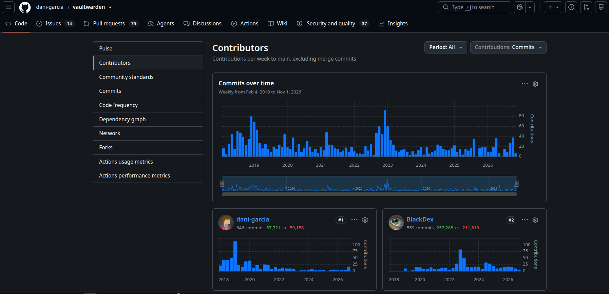
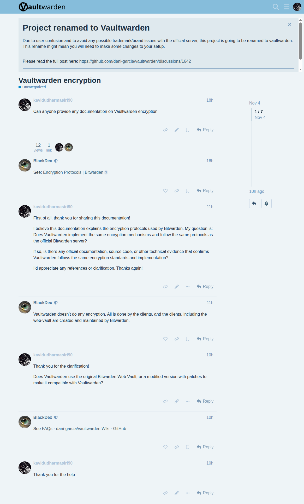
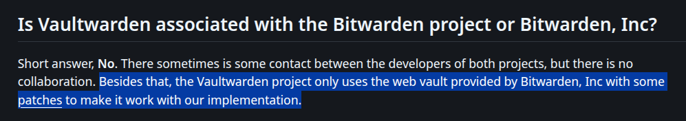
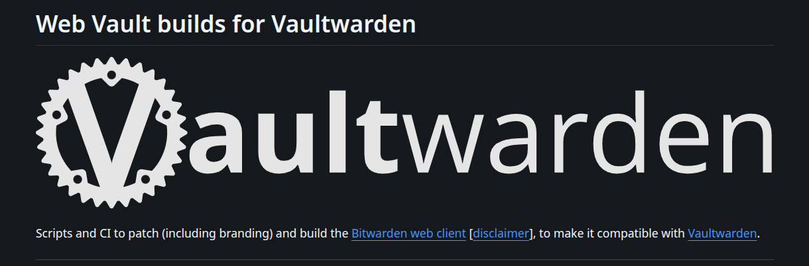
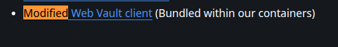

# Encryption

## Vaultwarden web vault encryption

## Discussion with vaultwarden contributors

BlackDex is a contributor for vaultwarden

url: https://github.com/dani-garcia/vaultwarden/graphs/contributors?all=1

url: https://vaultwarden.discourse.group/t/vaultwarden-encryption/5110/5

## does vaultwarden web vault uses bitwarden web vault

Yes, Vaultwarden uses the official Bitwarden web vault client, but with minor community-maintained patches applied to make it compatible with the Vaultwarden (formerly bitwarden_rs) server API.

url: https://github.com/dani-garcia/vaultwarden/wiki/FAQs

url: https://github.com/dani-garcia/bw_web_builds/blob/master/README.md

## does vaultwarden contains web vault

When you deploy Vaultwarden using its official Docker container images, a modified version of the Bitwarden web vault client is included and bundled directly inside the container

url: https://github.com/dani-garcia/vaultwarden

